# Catch & Go: MRT Location Analytics for an AR Game Pilot

An interactive Power BI report that recommends where a mobile AR game should pilot its new in-game creatures in Singapore. It combines resident survey data with MRT and public Wi-Fi location data.

**Tools:** Power BI · DAX · Azure Maps · Data storytelling
**Type:** Team project, Diploma in Applied AI & Analytics, Singapore Polytechnic (2026)
**Full report:** [Catch_and_Go_Report.pdf](report/Catch_and_Go_Report.pdf) (all 18 report pages)

---

## My Contribution

This was a team project. I owned **Rising Insight 1: Potential Player Reach**, the first of the four decision criteria.

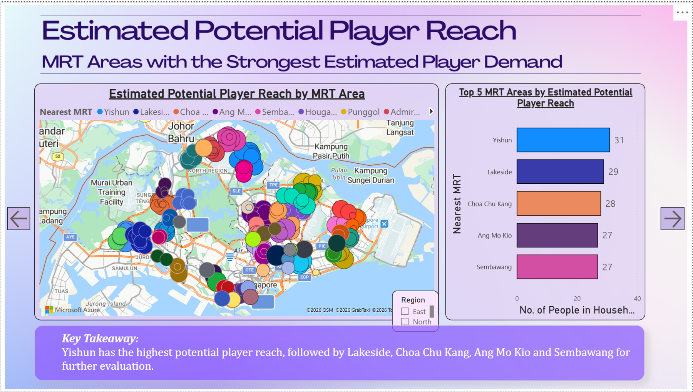

- Built the report page: an Azure Maps visual of estimated player reach by MRT area, a Top 5 ranked bar chart, and a region slicer.
- Defined estimated reach as the total household size of surveyed residents whose nearest station is each MRT.
- Found that **Yishun** has the highest potential player reach, followed by Lakeside, Choa Chu Kang, Ang Mo Kio and Sembawang. These five areas were carried forward to the other three criteria.

| Rank | MRT area | Estimated reach |
|---|---|---|
| 1 | Yishun | 31 |
| 2 | Lakeside | 29 |
| 3 | Choa Chu Kang | 28 |
| 4 | Ang Mo Kio | 27 |
| 5 | Sembawang | 27 |

---

## 1. Business Problem

Funtendo, a fictional game company, wants to release new Catch & Go creatures at public locations across Singapore. The busiest area is not always the best pilot site: if a location is hard to reach or has poor Wi-Fi, the pilot may underperform.

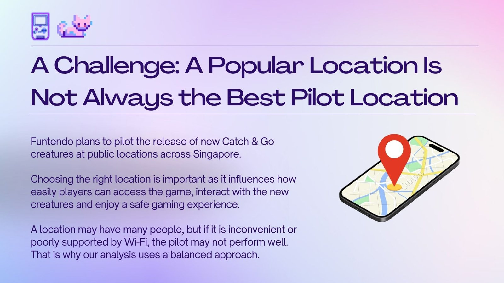

## 2. Data

| Source | Contents |
|---|---|
| Resident survey (n = 200) | Age group, gender, household income, household size, weekly gaming hours, main reason for playing |
| Location data | Nearest MRT station and distance, nearest public Wi-Fi hotspot and distance, resident coordinates |

## 3. Who Are the Players?

Before choosing a location, the report profiles the potential audience.

**Target audience.** Female residents form the majority of participants (56.5%), and residents aged 50 and above are the largest age group (48.5%).

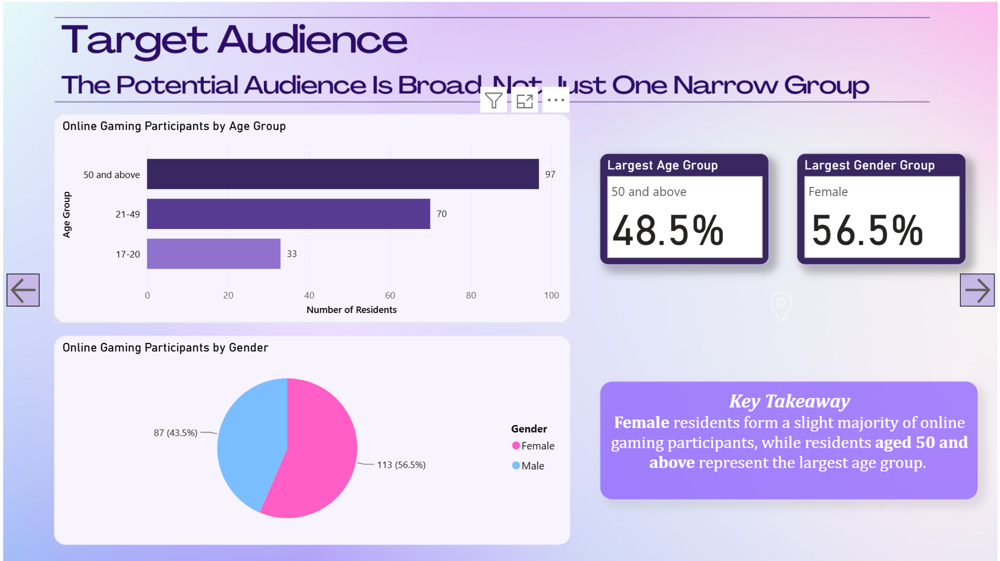

**Gaming engagement.** Playing 2 to 4 hours a week is the most common pattern. Every age group and both genders appear across many gaming-hour categories, so the audience is broad rather than one narrow group.

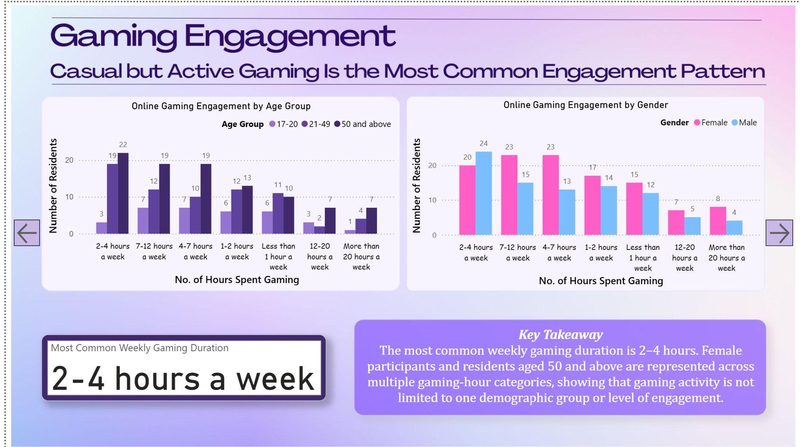

**Household income.** Residents earning $3,000 to $5,999 are the largest player group. Most of them play 2 to 4 or 7 to 12 hours a week.

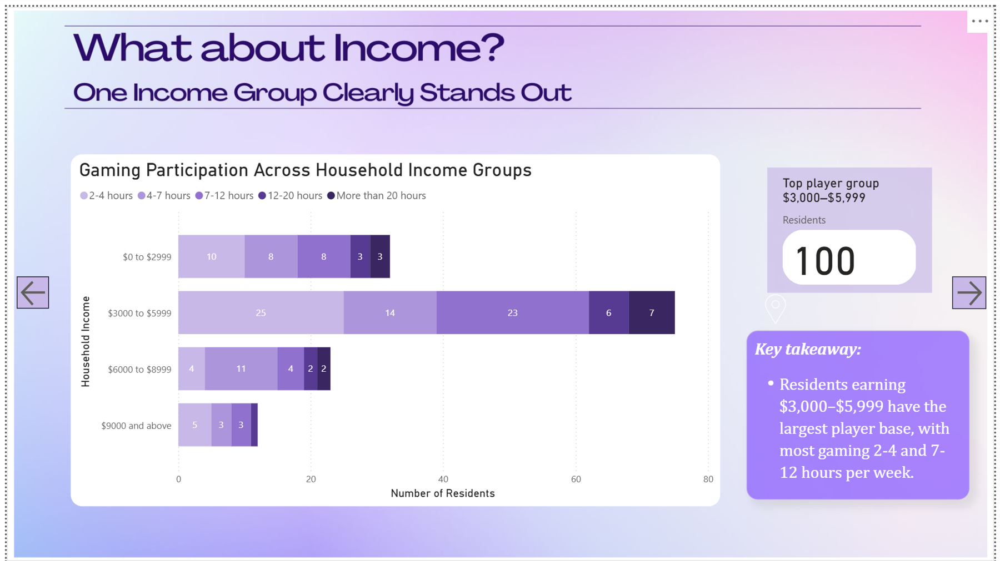

## 4. Decision Criteria

We scored MRT areas against four criteria. Each criterion has its own report page.

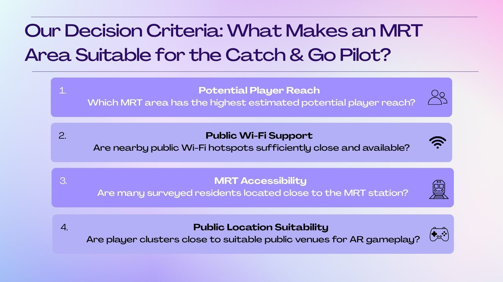

### Criterion 1: Potential Player Reach

See [My Contribution](#my-contribution). Yishun, Lakeside, Choa Chu Kang, Ang Mo Kio and Sembawang have the highest estimated reach.

### Criterion 2: Public Wi-Fi Support

A conditionally formatted matrix compares average Wi-Fi distance, number of nearby hotspots and household reach. A map then shows each resident's Wi-Fi access category.

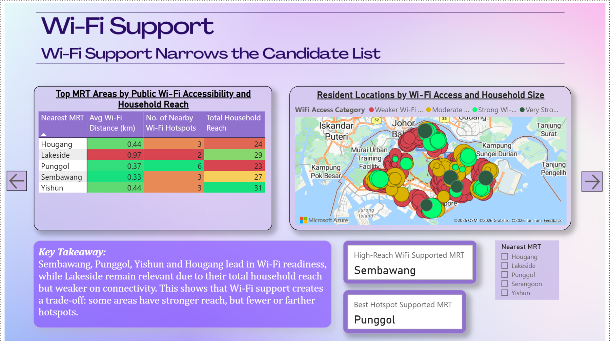

- Sembawang, Punggol, Yishun and Hougang lead on Wi-Fi readiness.
- Lakeside has strong reach (29) but weaker connectivity: 2 nearby hotspots, 0.97 km on average.
- Wi-Fi support involves a trade-off: some high-reach areas have fewer or farther hotspots.

### Criterion 3: MRT Accessibility

A scatter chart plots each MRT area's resident count against its residents' average distance to the station. Reference lines split the chart into quadrants.

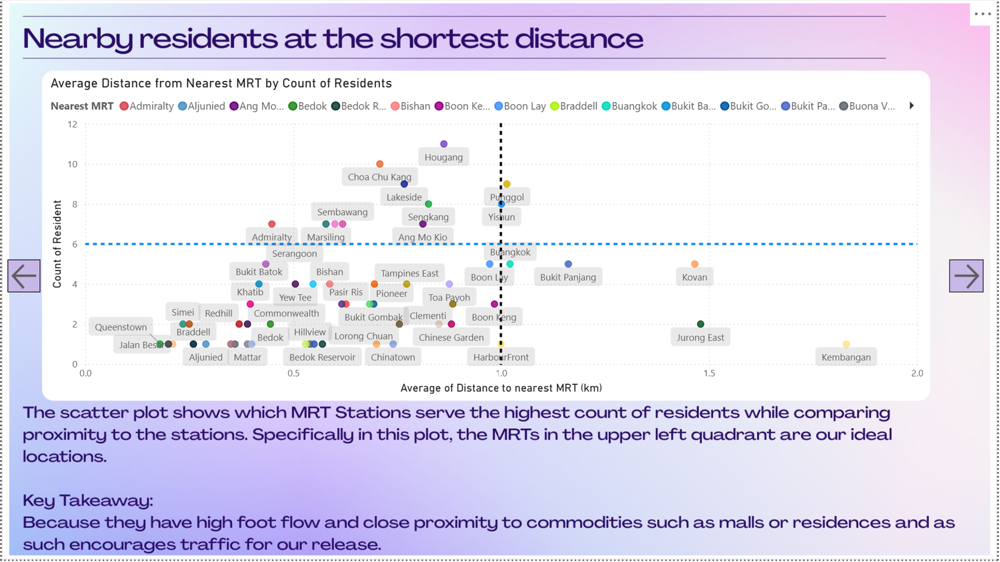

- Areas in the upper-left quadrant have many residents living close to the station.
- Hougang, Choa Chu Kang and Lakeside stand out there.

### Criterion 4: Public Location Suitability

A cluster map shows where residents concentrate. A bar chart ranks nearby public Wi-Fi venues by resident count. A slicer filters players by their reason for gaming.

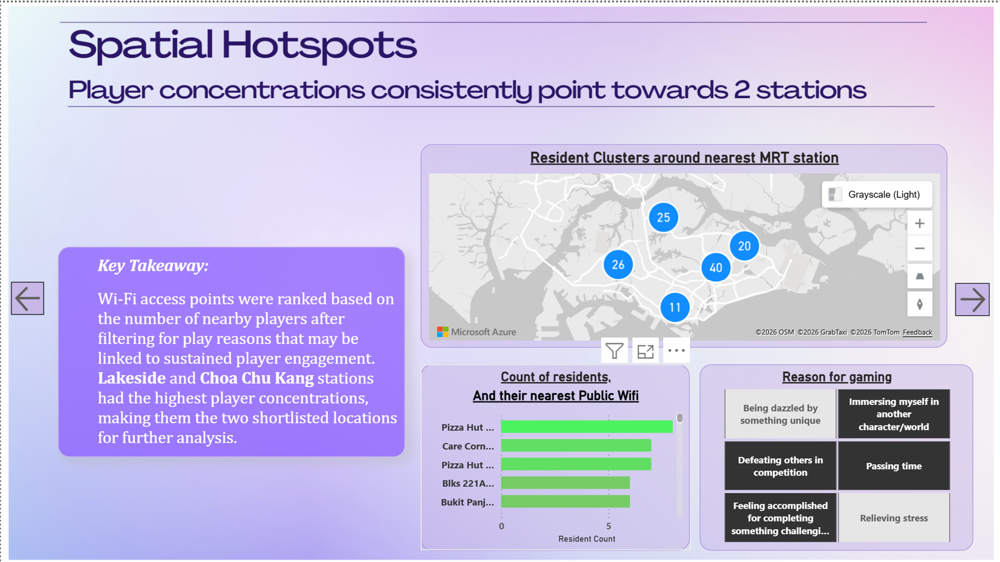

- After filtering for play reasons linked to sustained engagement, Lakeside and Choa Chu Kang have the highest player concentrations.

## 5. Results

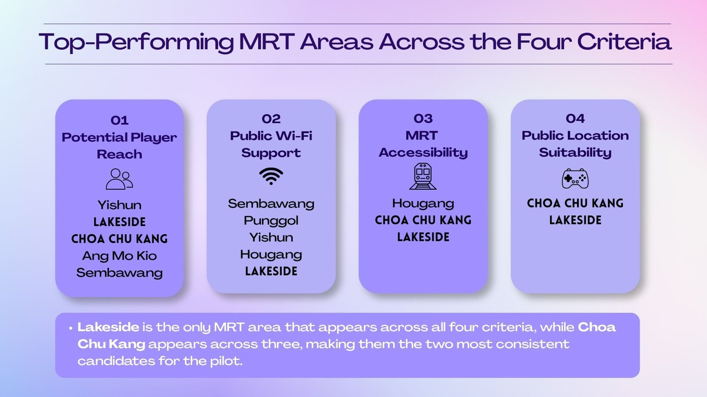

- **Lakeside** is the only MRT area that appears in the top group for all four criteria.
- **Choa Chu Kang** appears in three of the four.

| MRT area | Estimated reach | Avg. Wi-Fi distance | Criteria met |
|---|---|---|---|
| Lakeside | 29 | 0.97 km | 4 of 4 |
| Choa Chu Kang | 28 | 1.33 km | 3 of 4 |

## 6. Recommendation

Launch a controlled two-site pilot at **Choa Chu Kang and Lakeside**. Track player turnout, repeat participation and connection quality, then use the results before expanding to similar MRT areas.

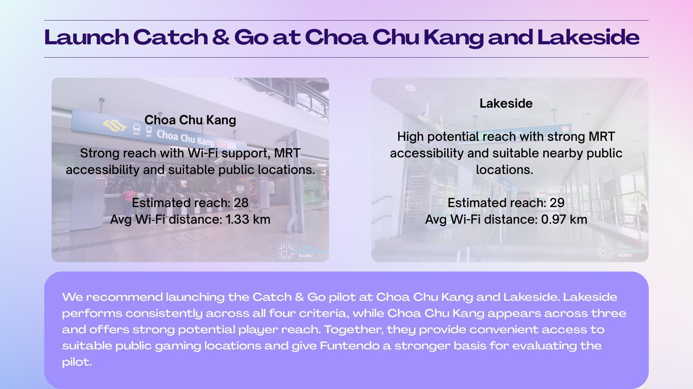

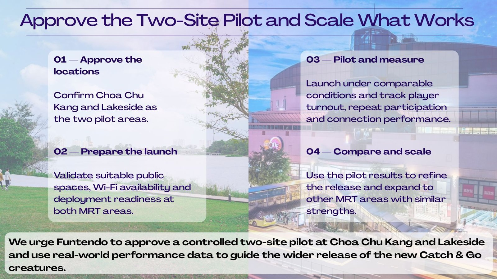

---

## Repository Structure

```
catch-and-go-mrt-analytics/
├── README.md
├── images/     Report page screenshots
└── report/     Full report as PDF (18 pages)
```

The `.pbix` file is not included because the dataset contains resident-level location and income data.
